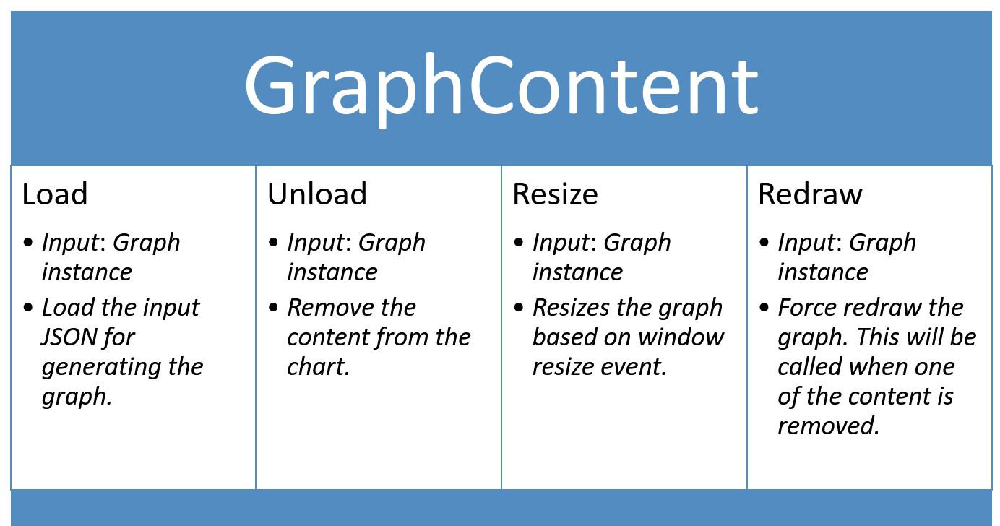

# Carbon Lifecycle

For a consistent development experience Carbon uses the same underlying interface for all graph types. All Carbon graphs are separated into 2 parts: `Construct` & `GraphContent`.

-   [Carbon Lifecycle](#carbon-lifecycle)
    -   [Construct](#construct)
        -   [`loadContent(input)`](#loadcontentinput)
        -   [`unloadContent(input)`](#unloadcontentinput)
        -   [`destroy`](#destroy)
    -   [Important information](#important-information)
    -   [GraphContent](#graphcontent)

## Construct

`Construct` is the base for `Graph` and other types of graph that serves as a container for the datasets (content). Usually this takes care of one or more of the following:

-   X Axis
-   Y Axis
-   Vertical Grid
-   Horizontal Grid
-   X Axis labels
-   Y Axis labels
-   Legend

Construct exposes following functions to handle the graph or its contents:

-   `generate` - Called internally when instantiating the graph
-   `loadContent` - Load a dataset in the graph
-   `unloadContent` - Remove a dataset from the graph
-   `resize` - Resizes the graph based on window resize event
-   `destroy` - Destroys the graph

### `loadContent(input)`

For Line, Paired Result and Bar graphs:

```javascript
var data = {
    key: "uid_1",
    label: {
        display: "Data Label 1"
    },
    values: [
        {
            x: "2016-03-01T12:00:00Z",
            y: 14
        },
        {
            x: "2016-04-10T12:00:00Z",
            y: 1
        },
        {
            x: "2016-11-01T12:00:00Z",
            y: 18
        }
    ]
};
var lineGraph = Carbon.api.graph(root);
lineGraph.loadContent(Carbon.api.line(data));
```

### `unloadContent(input)`

To remove a dataset from graph, the consumer has to provide the correspongind unique `key` and `label` object.

```javascript
lineGraph.unloadContent({
    key: "uid_1",
    trackLabel: {
        display: "Data Label 1"
    }
});
```

### `destroy`

Destroys the graph generated within the container.

```javascript
lineGraph.destroy();
```

## Important information

Only graphs that share the same rules of `Construct` can be combined together.

For instance:

-   A `Gantt` chart cannot be combined with a `Line` graph -> `Line` needs a X and Y axis whereas `Gantt` chart Construct only has X Axis when drawn.
-   A `Timeline` graph cannot be combined with a `Line` graph -> `Line` needs a X and Y axis whereas `Timeline` graph doesn't have a Y Axis.
-   `Line` graph can be combined with a `Bar` or `Paired Result`.

## GraphContent

`GraphContent` is the representation of the data-set drawn within the `Construct`. For instance, for `Line` graph, the `Construct` is the Axes, Labels and Legend while the `GraphContent` is the line itself.
Separation of container and content allows us to:

-   Render multiple `GraphContent`s within a single `Construct`.
-   Draw different combinations of graphs i.e. we can draw a _Combination graph_ with _2 Bar graphs_ or _1 Bar graph_ and _1 line graph_ without ever needing to building those natively in Carbon.
-   Draw different combinations of graph in any order necessary.


